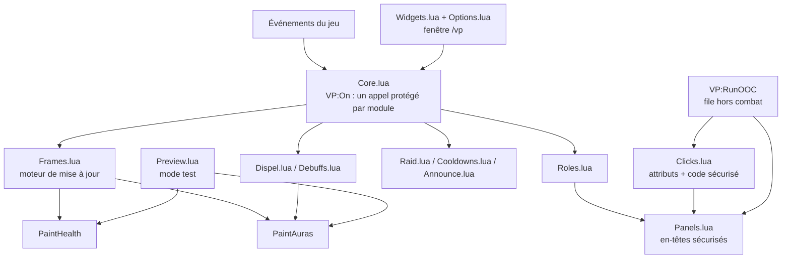
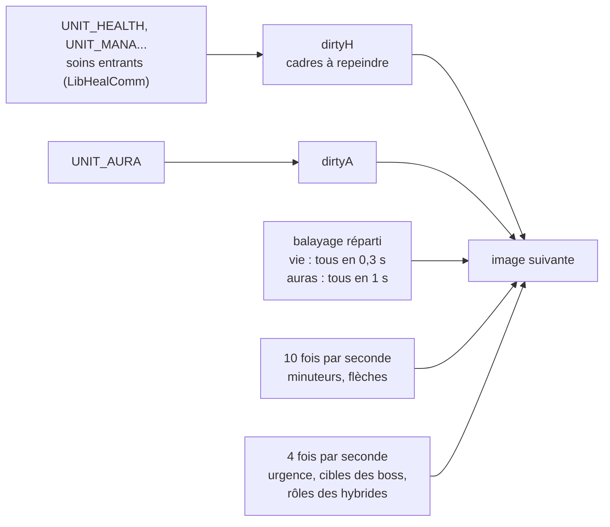
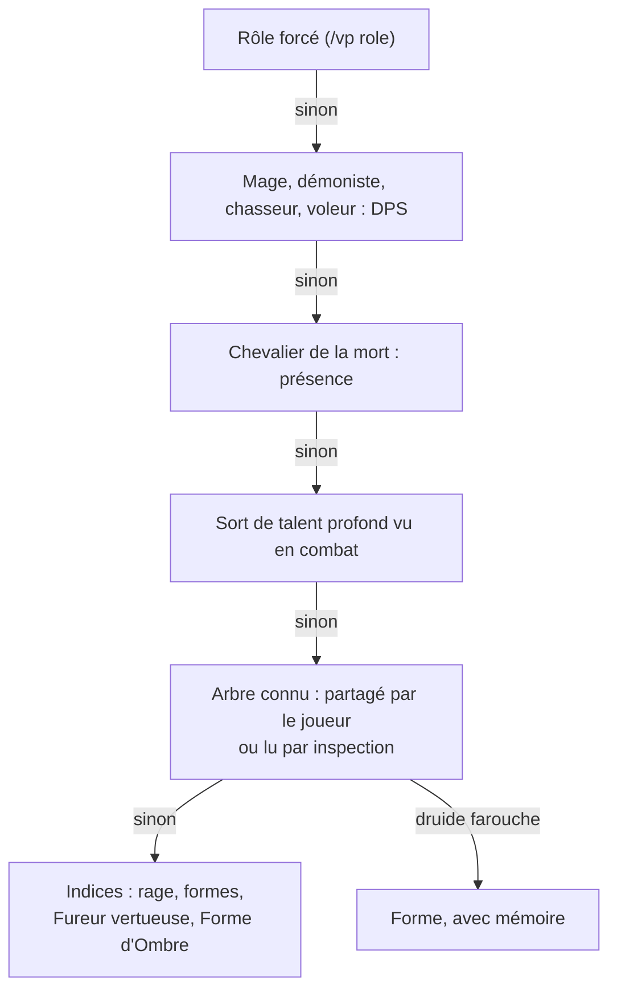

# Construction de VuhPlus

Ce document décrit comment VuhPlus est construit : ses objectifs, son architecture, les algorithmes de chaque module et les raisons des choix faits. Il s'adresse à qui veut comprendre le code, le vérifier ou y contribuer.

Version décrite : **5.9.1**.

## Sommaire

1. [Objectifs et contraintes](#1-objectifs-et-contraintes)
2. [Vue d'ensemble](#2-vue-densemble)
3. [Noyau](#3-noyau)
4. [Cadres et moteur de mise à jour](#4-cadres-et-moteur-de-mise-à-jour)
5. [Panneaux et tri du raid](#5-panneaux-et-tri-du-raid)
6. [Clic-soin et macros](#6-clic-soin-et-macros)
7. [Rôles](#7-rôles)
8. [Dispel](#8-dispel)
9. [Débuffs de boss](#9-débuffs-de-boss)
10. [Buffs et rappels de soigneur](#10-buffs-et-rappels-de-soigneur)
11. [Soin de zone](#11-soin-de-zone)
12. [Messages entre joueurs VuhPlus](#12-messages-entre-joueurs-vuhplus)
13. [Outils de raid](#13-outils-de-raid)
14. [Interface de configuration](#14-interface-de-configuration)
15. [Données sauvegardées](#15-données-sauvegardées)
16. [Performances](#16-performances)
17. [Vérification](#17-vérification)
18. [Limites connues](#18-limites-connues)
19. [Contribuer](#contribuer)

---

## 1. Objectifs et contraintes

**Objectifs**
- Donner à un soigneur, sur chaque cadre, ce qui compte à cet instant : vie manquante, HoTs, débuff à dissiper, débuff de boss, boucliers, soins entrants, portée.
- Soigner au clic sans délai, y compris en combat, sur n'importe quel bouton, touche ou molette.
- Ne jamais gêner en combat : pas d'erreur « action bloquée », pas d'à-coup, pas de module qui en bloque un autre.
- Rester accessible : interface en français, recherche, mode test, explication de chaque réglage.

**Contraintes**
- **Client 3.3.5a** (Interface `30300`). Une partie de l'API moderne n'existe pas encore :
  - pas de `C_Timer` (les minuteries sont des `OnUpdate` avec accumulateur) ;
  - pas de rôle hors de la Recherche de donjon (VuhPlus le détermine lui-même, voir [Rôles](#7-rôles)) ;
  - pas de montant de bouclier dans l'API (il est lu dans l'infobulle du buff) ;
  - pas de `RegisterAddonMessagePrefix`, apparu en 4.1 (les préfixes d'addon sont libres) ;
  - les réponses à l'appel ne sont envoyées qu'au chef et aux assistants.
- **Lua 5.1**, la version embarquée par le client.
- **Environnement sécurisé** : les cadres de soin sont des cadres protégés. Leurs attributs, leur taille et leur position ne peuvent pas changer en combat.
- **Aucune bibliothèque requise.** LibHealComm-4.0, LibSharedMedia-3.0 et LibResComm-1.0 sont utilisées si elles sont présentes (`LibStub(nom, true)`), jamais embarquées.

---

## 2. Vue d'ensemble

Les fichiers sont chargés dans l'ordre du `.toc`. Chaque fichier crée un module avec `VP:NewModule(nom)` ; le noyau appelle ensuite `OnLogin` de chaque module, dans l'ordre, à `PLAYER_LOGIN`.

| Fichier | Rôle |
|---|---|
| `Templates.xml` | modèles de boutons sécurisés (cadre de soin, petit cadre de dispel) |
| `Core.lua` | noyau : réglages, événements, file hors combat, profils, réglages par personnage, commandes |
| `Theme.lua`, `Colors.lua` | thème visuel, couleur d'accent, couleurs réglables |
| `Dispel.lua`, `Debuffs.lua` | dispel ; débuffs de boss et lecture partagée des affaiblissements |
| `Roles.lua` | rôle de chaque joueur |
| `Frames.lua` | cadres de soin : création, peinture, placement des icônes, moteur de mise à jour, appel |
| `Clicks.lua`, `Macros.lua` | clic-soin, touches au survol, macros à jetons |
| `Panels.lua` | panneaux, en-têtes sécurisés, tri du raid, familiers, minicarte |
| `Buffs.lua` | buffs manquants, rappels de soigneur, buff intelligent |
| `AoE.lua` | conseil de soin de zone |
| `Trinkets.lua` | bijoux et alerte de phase critique |
| `LiveList.lua` | fenêtre « À dissiper » et petits cadres de dispel |
| `Raid.lua`, `Consumables.lua` | alertes, état du raid, rapport de mort, barre d'outils, consommables |
| `Announce.lua`, `Cooldowns.lua` | annonces de vos sorts, recharges du raid |
| `Spikes.lua`, `Assign.lua`, `Rez.lua` | dégâts brutaux, assignations, résurrections |
| `Share.lua`, `AutoProfile.lua` | import / export en texte, profil automatique |
| `Preview.lua`, `Diag.lua` | mode test, diagnostic |
| `Widgets.lua`, `Options.lua` | boîte à outils d'interface et pages de la configuration |

---

## 3. Noyau

**Événements.** `VP:On(événement, fonction)` inscrit l'événement auprès d'un seul cadre caché et range la fonction dans une liste. À chaque événement, chaque fonction est appelée sous `pcall` : une erreur est remise au gestionnaire d'erreurs du jeu (relu à chaque fois, pour BugSack) sans empêcher les autres modules de recevoir le même événement. Le démarrage (`OnLogin` de chaque module) et le rafraîchissement global (`VP:RefreshAll`) sont protégés de la même façon.

**File hors combat.** `VP:RunOOC(clé, fonction)` exécute tout de suite hors combat ; en combat, la fonction est rangée sous sa clé et exécutée à `PLAYER_REGEN_ENABLED`. Une même clé n'est exécutée qu'une fois : dix changements de disposition en combat donnent une seule mise en page à la fin.

**Réglages.** `VP.defaults` décrit tous les réglages d'affichage. Au chargement, les valeurs manquantes sont copiées depuis les valeurs par défaut (`copyDefaults`), les anciens formats sont convertis (`migrate`) et les listes sont remises en ordre (`fixLists`). Les clés de `PERSIST` (clics, touches, macros, profils, assignations...) ne font pas partie d'un profil.

**Réglages par personnage.** Le fichier de sauvegarde est commun au compte. Les réglages « vivants » restent à la racine de `VuhPlusDB` ; à la déconnexion, une copie est rangée dans `chars["Nom - Royaume"]`, et remise en place à la connexion suivante de ce personnage. Un personnage inconnu démarre avec les réglages du dernier personnage joué.

---

## 4. Cadres et moteur de mise à jour

### Création

Chaque cadre de soin est un bouton sécurisé (`VuhPlusUnitTemplate`, hérité de `SecureUnitButtonTemplate`), créé par un en-tête de groupe du jeu. Son `OnLoad` appelle `F:SetupButton`, qui crée la barre de vie, la barre de mana, les icônes (6 HoTs, dispel, boss, défensif, soins réduits, pierre d'âme, rappel, rôle, chef, symbole, flèche) et les bordures (urgence, dispel, symbole, assignation, incantation, dégâts brutaux, cible du boss). Le changement d'attribut `unit` (nouveau joueur derrière le cadre) remet à zéro ses alertes et redessine tout.

La taille des cadres créés en combat est donnée par le code sécurisé de l'en-tête (`initialConfigFunction`), qui lit `vp-w` et `vp-h` sur l'en-tête : un joueur qui arrive en combat a tout de suite la bonne taille.

### Lecture et peinture séparées

`F:UpdateHealth(b)` lit l'état réel de l'unité dans une table réutilisée, puis appelle `F:PaintHealth(b, S)`. `F:UpdateAuras(b)` fait de même avec `F:PaintAuras(b, A)`. Les fonctions de peinture ne lisent jamais le jeu : le mode test (`Preview.lua`) les appelle avec des données fictives, et l'affichage du mode test est donc exactement celui du jeu.

Les affaiblissements d'une unité sont lus **une seule fois** (`Debuffs:ReadHarmful`) dans un tampon réutilisé, puis partagés par le dispel, les débuffs de boss, les soins réduits et les emplacements de HoTs qui suivent un affaiblissement.

### Moteur

- Un événement ne repeint pas tout de suite : il marque les cadres concernés (table `GUID → cadres`, reconstruite seulement quand le groupe ou un cadre change). Dix événements dans la même image donnent une seule peinture.
- Un balayage de sécurité parcourt les cadres en round-robin : tous les cadres en environ 0,3 s pour la vie (0,5 s au-delà de 25 joueurs) et 1 s pour les auras (1,5 s). Il est plafonné à un tour complet par image : après un écran de chargement, il ne rattrape pas des milliers de mises à jour d'un coup.
- Les minuteurs ne tournent que sur les cadres qui affichent quelque chose de minuté (`hasTimed`) et les flèches seulement sur les joueurs hors de portée.
- Le rôle des classes hybrides (prêtre, paladin, druide, chevalier de la mort) est relu après un changement d'aura, regroupé 4 fois par seconde au plus, et l'icône n'est redessinée que si elle change.
- Les appels à l'affichage (`SetValue`, `SetStatusBarColor`, `SetText`) ne sont faits que si la valeur change.

### Boucliers

Le client 3.3.5 ne donne pas le montant d'un bouclier. `UpdateAuras` relève les indices des buffs de bouclier ; `F:ShieldAmount` lit le montant dans l'infobulle de chaque buff avec une infobulle cachée unique (`VP:ScanTip`), au plus deux fois par seconde par cadre, et tout de suite quand un bouclier apparaît ou disparaît. Pour le Bouclier sacré, seul l'effet déclenché (58597) compte : le buff posé par le paladin porte le même nom.

### Placement des icônes

Deux modes :
- **Individuel** (`ArrangeFree`) : chaque icône à sa position, avec son décalage et sa taille. Avec « Éviter les chevauchements », une icône dont la place est prise cherche la place libre la plus proche (vers l'intérieur du cadre, puis en hauteur), dans l'ordre de priorité : débuff de boss, dispel, HoT 1 à 6, puis le reste.
- **Alignement automatique** (`Arrange`) : les icônes d'une même position forment une zone, alignées sans chevauchement et réduites si la place manque ; le nom et le texte de vie se décalent.

Le placement n'est refait que si l'empreinte des icônes visibles (un entier, un bit par icône) change.

### Appel (ready check)

Voir [Messages entre joueurs VuhPlus](#12-messages-entre-joueurs-vuhplus). Une réponse « prêt » n'est jamais remplacée ; une réponse reçue ne redevient jamais « en attente ». Sans information sur un joueur, aucune icône n'est affichée : jamais de croix inventée. Les icônes disparaissent quelques secondes après la dernière réponse, à la fin de l'appel, ou à l'entrée en combat.

---

## 5. Panneaux et tri du raid

Les panneaux sont des ancres déplaçables qui portent des en-têtes sécurisés (`SecureGroupHeaderTemplate`, `SecureGroupPetHeaderTemplate`). Leur position est enregistrée en coordonnées d'écran (coin haut gauche) et `SetUserPlaced(false)` empêche le client de la remplacer par une position mémorisée par personnage.

| Tri | Construction |
|---|---|
| Par groupe | 8 en-têtes, un par groupe (`groupFilter`), avec titre ; groupes vides rangés à la fin en mode compact |
| Par classe, par nom | un seul en-tête en colonnes |
| Par rôle, en blocs | les 3 premiers en-têtes, chacun filtré par une liste de noms (`nameList`) : Tanks, Soigneurs, DPS dans l'ordre choisi |
| Par rôle, en grille | la grille a la forme du tri par groupe (colonnes pleines, seule la dernière reçoit le reste : 5 / 5 / 1 à 11 joueurs) et se remplit ligne par ligne ; chaque ligne est découpée en morceaux d'un seul rôle, un en-tête par morceau (8 au plus, la grille s'élargit sinon) |

Les listes de noms sont reconstruites hors combat : quand un rôle change, quand le groupe change, et toutes les 5 secondes hors combat (forme, présence, spé), avec une nouvelle mise en page seulement si le contenu des listes a changé. L'ordre exact des joueurs dans un en-tête sécurisé n'est pas réglable en 3.3.5, d'où les listes de noms.

Les familiers peuvent être placés sous le groupe (ou le bloc) de leur maître, à côté des joueurs, ou dans un panneau séparé. Les invocations de quelques secondes (tréants, loups esprits, ombrefiel) sont ignorées par défaut : elles feraient bouger les cadres en plein combat.

---

## 6. Clic-soin et macros

**Attributs.** `C:Apply` calcule tous les attributs de clic voulus (`type`, `spell`, `macrotext`... pour chaque combinaison) dans une table, puis les écrit sur chaque en-tête et chaque bouton, **seulement s'ils ont changé**. Sur un en-tête, l'attribut `_ignore` suspend son placement pendant l'écriture : sans cela, chaque `SetAttribute` relancerait tout le placement de l'en-tête. Les cadres Cible / Focus et les cadres Blizzard ne reçoivent pas les actions « hostiles », pour ne jamais lancer une Métamorphose en cliquant sur un monstre ciblé.

**Code sécurisé.** Chaque bouton est enveloppé (`WrapScript`) par un gestionnaire `SecureHandlerStateTemplate` :
- `OnClick` : clic intelligent (résurrection sur un mort hors combat), action hostile sur un allié contrôlé, macros à jetons, bijoux automatiques ;
- `OnEnter` / `OnLeave` / `OnHide` / `OnShow` : touches du clavier et molette au survol, posées avec `SetBindingClick` et retirées à la sortie.

**Macros à jetons.** Une macro contenant `@vp` ou `{vp}` est découpée hors combat en morceaux rangés dans des attributs (`vp-mac-<clic>-<n>`). Au clic, le code sécurisé recolle les morceaux avec l'unité du bouton (`@raid5`, `raid5`) et lance le résultat. Le texte de secours (`@mouseover`) sert là où le code sécurisé n'est pas encore installé. La vérification (`Macros:Check`) calcule la longueur réelle avec le pire cas (`@raidpet40`).

---

## 7. Rôles

`R:GetRole(unité)` renvoie `"TANK"`, `"HEALER"`, `"DAMAGER"` ou `nil` :

**Inspection.** Toutes les 2 secondes hors combat, un joueur à portée (28 m) est inspecté avec `NotifyInspect`. Les talents reçus ne sont acceptés que s'ils viennent bien du joueur inspecté par VuhPlus (une inspection faite par un autre addon entre-temps est ignorée), si ni lui ni vous n'êtes mort ou fantôme, et s'ils ne portent pas les arbres de votre propre classe (réponse erronée du serveur). Un arbre n'est retenu qu'après **deux lectures identiques**. Délai de 5 s par inspection, 60 s d'attente après un échec, revérification toutes les 2 minutes. Un sort « Activation de la spécialisation » lancé par un membre du groupe le fait réinspecter en priorité.

**Preuves par sort.** Certains sorts sont des talents profonds d'un seul arbre (Dévastation, Bouclier du vengeur, Pénitence, Remous, Croissance sauvage, Frappe mortelle...). Les voir lancés dans le journal de combat prouve la spé, sans inspection.

**Druide farouche.** Les mêmes talents servent à tanker et à faire des dégâts : la forme décide (rage ou forme d'ours = tank, énergie ou forme de félin = DPS). Le rôle retenu a une **mémoire** : une autre forme ne compte que si elle est gardée **30 secondes d'affilée en combat**. Un tank qui passe en félin pour se déplacer entre deux packs reste un tank. Un changement de spé efface cette mémoire. Le chevalier de la mort suit la même règle avec sa présence.

**Spé partagée.** Voir [Messages entre joueurs VuhPlus](#12-messages-entre-joueurs-vuhplus). Un joueur qui a envoyé sa spé depuis moins de 5 minutes n'est plus inspecté.

---

## 8. Dispel

- **Sorts.** Les sorts de dispel de la classe sont cherchés dans le grimoire (`GetSpellInfo(nom)` ne répond que pour un sort connu) : au plus deux emplacements, chacun avec les types qu'il retire. Tout est relu au changement de sorts, de talents ou de spé.
- **Choix du débuff.** Parmi les affaiblissements dissipables par vous, celui dont le type est le premier dans l'ordre choisi. Sont écartés : la liste « à ne pas dissiper » (intégrée et personnelle), les affaiblissements sans effet sur la classe du joueur, et un poison ou une maladie déjà sous votre Abolir. Affliction instable est signalée « DANGER » au lieu d'inviter à dissiper.
- **Portée et ligne de vue.** La portée est celle de VOTRE sort (`IsSpellInRange`). Une erreur « hors de la ligne de vue » juste après votre dispel (moins de 1,5 s) met le joueur de côté quelques secondes.
- **Son.** À la première apparition du débuff, ou quand le joueur revient à portée ; au plus un son toutes les 2 secondes.
- **Sans cadres de soin.** Si les cadres sont cachés (`/vp cadres`), le groupe est lu directement 3 fois par seconde, pour que la liste « À dissiper », le son et les petits cadres continuent de fonctionner.
- **Petits cadres.** Un en-tête sécurisé de petits boutons (`VuhPlusCureTemplate`) : clic gauche, droit, milieu = Dispel 1, Dispel 2, cibler. Les couleurs ne sont pas protégées et suivent en combat.

---

## 9. Débuffs de boss

90 identifiants de sorts (Naxxramas, Malygos, Sartharion, Ulduar, Épreuve du croisé, Onyxia, Citadelle de la Couronne de glace, Sanctum rubis) servent à retrouver le **nom** dans la langue du client. La détection se fait par nom : toutes les difficultés et tous les rangs sont couverts. Chaque débuff a une priorité de 1 à 10 (5 par défaut) ; la liste personnelle l'emporte. Le cadre montre le plus prioritaire ; à partir de 8 (« critique »), l'icône clignote et le son par défaut se déclenche. Un seuil permet de n'afficher que les débuffs d'une priorité minimale. Les affaiblissements sans intérêt pour un soigneur (Rassasié, Épuisement, Récemment bandé, Hypothermie, Déserteur...) ne sont jamais montrés dans la rangée des autres débuffs.

---

## 10. Buffs et rappels de soigneur

`Buffs:Scan` passe toutes les secondes (2 s au-delà de 25 joueurs). Pour chaque buff suivi de votre classe :
- **groupe** : point jaune sur les joueurs à qui il manque ;
- **personnel** et **arme** : votre cadre devient gris (l'enchantement d'arme est lu dans l'infobulle de l'arme, gardé 5 s) ;
- **tank** : le cadre du tank devient gris s'il lui manque votre sort, ou s'il reste trop peu de charges.

Règles particulières :
- un buff n'est « manquant » que s'il lui reste moins du seuil choisi, sans jamais dépasser un quart de sa durée (sinon les buffs courts seraient toujours manquants) ;
- sorts uniques (Bouclier de terre, Guide de lumière, Bouclier sacré) : la personne qui porte VOTRE sort est suivie même si elle n'est pas reconnue comme tank ; seul le porteur est grisé ;
- sorts qui ne se cumulent pas entre joueurs (Bouclier de terre, Épines, Gardien de peur) : un tank qui a déjà celui d'un autre joueur est couvert ;
- un sort en recharge (Gardien de peur) ne grise personne ;
- `UnitBuff(unité, nom)` ne renvoie que le premier buff de ce nom : quand il n'est pas le vôtre, la liste complète est parcourue (deux paladins sur le même tank).

---

## 11. Soin de zone

Le client donne la position des joueurs sur la carte (`GetPlayerMapPosition`), en fraction de la carte, mais pas la taille de la carte en mètres. VuhPlus apprend cette échelle en jeu :

1. Pour chaque joueur, la distance sur la carte `d` est comparée à des distances connues : portée de votre soin (40 m, `IsSpellInRange`), distance de duel (9,9 m) et de suivi (28 m) (`CheckInteractDistance`).
2. Un joueur **à portée** d'une distance `D` donne une borne haute de l'échelle `D / d` ; **hors de portée**, une borne basse.
3. Quand la borne haute ne dépasse pas 1,35 fois la borne basse, l'échelle retenue est leur moyenne. Des mesures contradictoires (étage différent, carte changée) remettent l'apprentissage à zéro, comme un changement de zone ou de carte.

Avec une échelle fiable, chaque joueur à portée est évalué comme cible : on compte les blessés dans le rayon du sort autour de lui, on garde les plus blessés dans la limite de cibles du sort, et la cible qui a le plus de vie manquante soignable est teintée. Sans échelle (instance sans carte, carte du monde ouverte), la méthode par groupe de raid est utilisée. La largeur de la carte est ramenée par un rapport de 1,5 (les cartes sont 1,5 fois plus larges que hautes).

---

## 12. Messages entre joueurs VuhPlus

Les messages passent par `SendAddonMessage` sur le canal du groupe (`RAID`, `PARTY`, ou `BATTLEGROUND` en champ de bataille). **Rien n'est exécuté à la réception** : chaque message est comparé à un motif strict, l'expéditeur doit être un membre du groupe (`UnitGUID(nom)`), et tout ce qui ne correspond pas est ignoré.

| Préfixe | Message | Envoi | Lecture |
|---|---|---|---|
| `VuhPlusRC` | `R:1` / `R:0` | ma réponse à l'appel (bouton Prêt / Pas prêt) | réponse de l'expéditeur |
| `VuhPlusRC` | `B:Nom=1,Nom=0,Nom=a` | un chef ou assistant relaie les réponses que le serveur lui donne, au plus une fois par seconde, découpé sous 220 caractères | réponse de chaque nom du groupe (`1` prêt, `0` pas prêt, `a` sans réponse) |
| `VuhPlusCD` | `S:id=secondes,id=secondes` | recharge réelle de mes sorts suivis, 1,6 s après un lancement, quand le groupe ou mes talents changent, puis toutes les 2 minutes ; 3 s minimum entre deux envois | recharge exacte et liste des sorts possédés ; identifiants inconnus ou durées au-delà d'une heure ignorés |
| `VuhPlusRole` | `T:1` à `T:3` | arbre principal de mes talents, quand le groupe ou mes talents changent, puis toutes les 2 minutes ; 3 s minimum entre deux envois | arbre de l'expéditeur, retenu tout de suite ; son inspection est arrêtée pendant 5 minutes |

À l'arrivée dans un groupe, chaque envoi attend un délai au hasard de quelques secondes : 25 joueurs qui arrivent ensemble n'envoient pas tous à la même seconde. Les deux partages (recharges, spé) peuvent être coupés dans la configuration ; coupés, rien n'est envoyé ni lu.

---

## 13. Outils de raid

- **Annonces** (`Announce.lua`) : vos gros sorts détectés dans le journal de combat (`SPELL_CAST_SUCCESS`). Mode discret par défaut : une seule ligne au groupe pour les sorts de raid, en instance, au plus un message toutes les 3 s ; le reste dans votre chat. Barres de temps à l'écran pour vos sorts et, en option, ceux des autres. La recharge réelle est relue après le temps de recharge global.
- **Recharges du raid** (`Cooldowns.lua`) : une photo du groupe est prise une fois par rafraîchissement. Vos sorts : recharge lue dans le jeu. Les autres : recharge envoyée par leur VuhPlus, sinon recharge de base comptée dès que le sort est vu lancé. Un sort de talent n'est affiché qu'après avoir été vu lancé (on ne connaît pas les talents des autres).
- **Rapport de mort** (`Raid.lua`) : le dernier coup reçu par chaque membre est gardé dans une table réutilisée ; `SPELL_INSTAKILL` couvre les morts sans dégâts. Annoncé au groupe, les morts des 2 dernières secondes partent ensemble, et seulement par le chef ou un assistant (le chef seul en groupe de 5).
- **Dégâts brutaux** (`Spikes.lua`) : tampon circulaire de 12 coups par joueur, somme sur la fenêtre choisie comparée à la vie maximale.
- **Résurrections** (`Rez.lua`) : vos incantations, `SPELL_RESURRECT` du journal de combat pour celles réussies de tout le groupe, et LibResComm-1.0 si elle est installée pour celles en cours des autres.
- **Consommables**, **barre d'outils**, **assignations**, **bijoux** : voir le README.

---

## 14. Interface de configuration

La fenêtre `/vp` est construite par `Widgets.lua` (boîte à outils) et `Options.lua` (contenu). Chaque page est un objet `Page` qui place ses réglages en une ou deux colonnes, dans des cartes repliables. Chaque élément garde sa position « naturelle » ; `Relayout` le replace en tenant compte des cartes repliées au-dessus de lui.

- **Recherche** : les méthodes qui créent un réglage enregistrent leur libellé. La recherche compare des textes normalisés (sans accents ni codes de couleur) et propose d'abord les pages dont le nom ou les synonymes correspondent.
- **Annuler** : une copie complète des réglages est prise à l'ouverture de la fenêtre ; « Annuler » la remet en place et reconstruit les pages.
- **Mode test** : 40 faux cadres créés sans en-tête sécurisé, peints par les mêmes fonctions que les vrais.

---

## 15. Données sauvegardées

Une seule variable sauvegardée, `VuhPlusDB`, commune au compte :

| Clé | Contenu |
|---|---|
| réglages d'affichage (`width`, `iconPos`, `dispel`, `buffs`...) | réglages du personnage connecté (voir `VP.defaults`) |
| `chars` | copie des réglages de chaque personnage, par « Nom - Royaume » |
| `profiles` | profils enregistrés |
| `binds`, `keys`, `hostile` | clics, touches et actions hostiles, par classe puis par spé |
| `macros` | bibliothèque de macros |
| `hotSlots` | emplacements de HoTs, par classe |
| `myTanks`, `spotlight`, `assign`, `customDebuffs`, `roleOverride` | listes du joueur |
| `autoProfile`, `uiShowAll`, `uiScale`, `diag` | profil automatique, préférences de la fenêtre, diagnostic |

Les conversions d'anciens formats sont faites une seule fois, repérées par des drapeaux (`posV2`, `petsV1`, `petsV2`, `announceLightV1`, `announceQuietV1`, `fix433`). Une valeur abîmée d'une clé commune est remplacée par sa valeur par défaut au chargement. Un profil importé est vérifié en profondeur d'après les valeurs par défaut (type de chaque valeur, bornes des tailles) avant d'être enregistré.

---

## 16. Performances

- Événements regroupés à l'image suivante, balayage réparti et plafonné (voir [Moteur](#moteur)).
- Tables réutilisées partout où le code tourne souvent : état d'une unité, affaiblissements, HoTs, photo du groupe pour les recharges, tampons du dispel et des dégâts brutaux, liste des joueurs du groupe.
- Une seule lecture des affaiblissements par unité et par mise à jour, partagée par quatre fonctions.
- Lecture d'infobulle des boucliers limitée à deux fois par seconde par cadre.
- Fréquences : buffs 1 s, soin de zone 0,5 s, liste « À dissiper » 0,2 s, recharges du raid 0,5 s (0,1 s juste après un lancement), alertes 0,25 s, état du raid 1 s, inspection 2 s, tri par rôle 5 s hors combat.
- Cadres cachés (`/vp cadres`) : le moteur des cadres ne tourne plus du tout.

Mesure dans le banc de simulation (raid 25, 2 minutes de combat, vie et auras de tout le raid modifiées trois fois par seconde, 30 images par seconde) : environ 4,8 Mo de mémoire allouée en 5.9.0, contre 5,3 Mo en 5.8.5.

---

## 17. Vérification

**À chaque envoi sur GitHub** (`.github/workflows/verification.yml`) :
- syntaxe Lua 5.1 de tous les fichiers (`luac5.1 -p`) ;
- fichiers déclarés dans `VuhPlus.toc` présents, et chaque fichier Lua déclaré ;
- numéro de version identique dans `Core.lua` et `VuhPlus.toc`, et section correspondante dans `CHANGELOG.md` ;
- en-tête de licence en tête de chaque fichier Lua ;
- banc de simulation.

**Banc de simulation** (`tests/`) : il fait tourner le vrai code de l'addon dans Lua 5.1 (bibliothèque Python `lupa`) avec un faux client 3.3.5 (`tests/mock.lua`). Le faux client ne définit que des fonctions qui existent en 3.3.5, et toute lecture d'une variable globale inconnue est une erreur : un appel à une fonction d'une version plus récente du jeu fait échouer le banc. Il simule les unités, le groupe, l'inspection, les événements, le temps qui passe (scripts `OnUpdate` des cadres visibles) et le verrouillage de combat.

| Scénario | Ce qui est vérifié |
|---|---|
| `scenario_1_demarrage.lua` | chargement, raid de 10, une minute de jeu, combat, dispel, les 19 pages de la configuration, recherche, mode test à 40, commandes, réglages par personnage |
| `scenario_2_druide_tank.lua` | tri par rôle avec un druide tank : félin hors combat, félin court ou long en combat, retour en ours, changement de spé |
| `scenario_3_groupe.lua` | rapport de mort selon le chef, relais de l'appel, recharges reçues, import de profil piégé ou hors bornes, vérification et conversion des macros |
| `scenario_4_charge.lua` | raid 25 en combat pendant 2 minutes : aucune erreur, mémoire allouée |
| `scenario_5_role_partage.lua` | spé partagée : envoi, réception, inspection évitée, messages invalides, partage coupé |

Lancer le banc : `pip install lupa`, puis `python tests/run.py . tests/scenario_*.lua` depuis la racine du dépôt.

Le banc ne remplace pas un essai en jeu : il ne simule ni l'affichage, ni le placement des cadres par les en-têtes sécurisés, ni les réponses réelles du serveur.

---

## 18. Limites connues

- **Rôle des autres sans VuhPlus** : il faut une inspection (hors combat, à 28 m) ou un sort de talent vu en combat. Un joueur qui rejoint le raid en combat a son rôle à la fin du combat.
- **Druide farouche** : rôle déduit de la forme, avec 30 s de mémoire en combat ; un druide qui alterne réellement tank et DPS dans le même combat est vu avec ce délai.
- **Ordre dans un bloc** : les en-têtes sécurisés de la 3.3.5 ne permettent pas un ordre libre ; les joueurs d'un bloc sont triés par nom.
- **Joueur arrivé en combat** : placé dans son bloc de rôle à la fin du combat (limite des cadres sécurisés).
- **Montant des boucliers** : lu dans l'infobulle, il dépend du texte du client et suppose un nombre sans séparateur de milliers.
- **Soin de zone et flèches** : impossibles dans une instance sans carte ; la méthode par groupe prend alors le relais.
- **Recharges des autres sans VuhPlus** : recharge de base, sans talents ni glyphes ; un sort de talent n'apparaît qu'après avoir été vu lancé.
- **Fenêtre de configuration** : charger un profil ou « Annuler » reconstruit les pages ; les anciennes ne sont pas libérées (le jeu ne libère jamais un cadre). Sans effet visible, mais la mémoire de l'interface grandit un peu à chaque fois.

---

## Contribuer

Règles à respecter pour toute modification :

1. **Lua 5.1 et API 3.3.5 uniquement.** Rien de `C_Timer`, `ENCOUNTER_START`, `RegisterAddonMessagePrefix`, `C_*`... Le banc de simulation échoue sur toute fonction absente du client 3.3.5.
2. **Aucune bibliothèque embarquée.** Une bibliothèque facultative est appelée avec `LibStub(nom, true)` et son absence doit être prévue.
3. **Rien de protégé en combat** : tout changement d'attribut, de taille ou de position d'un cadre sécurisé passe par `VP:RunOOC`.
4. **Aucune variable globale** en dehors de celles déjà déclarées (`VuhPlus`, `VuhPlusDB`, commandes, raccourcis, fonctions appelées par `Templates.xml`).
5. **Données sauvegardées compatibles** : une nouvelle clé reçoit sa valeur par défaut dans `VP.defaults` ; un changement de format est converti une seule fois dans `migrate`, avec un drapeau.
6. **Messages entre joueurs compatibles** : un nouveau format a un nouveau motif ou un nouveau préfixe, et les anciens messages restent lus ou ignorés sans erreur. Rien de reçu n'est exécuté.
7. **Textes affichés et commentaires en français.** Les commentaires expliquent pourquoi, plutôt que quoi.
8. **En-tête de licence** de deux lignes en tête de chaque fichier Lua.
9. Les scénarios du banc passent, et un scénario couvre la modification quand c'est possible.

Voir aussi [CONTRIBUTING.md](../CONTRIBUTING.md).
